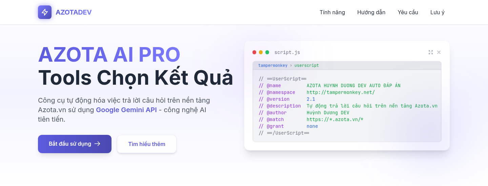
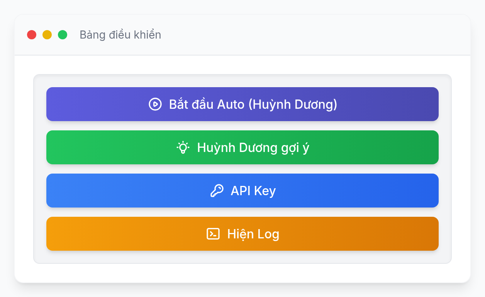
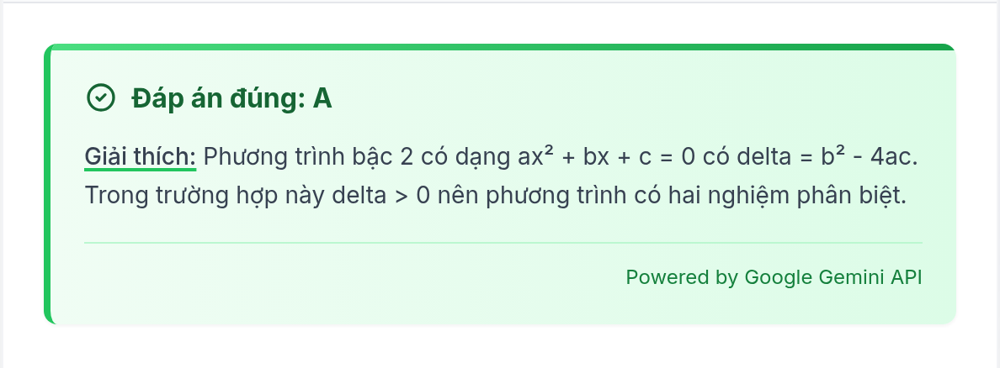
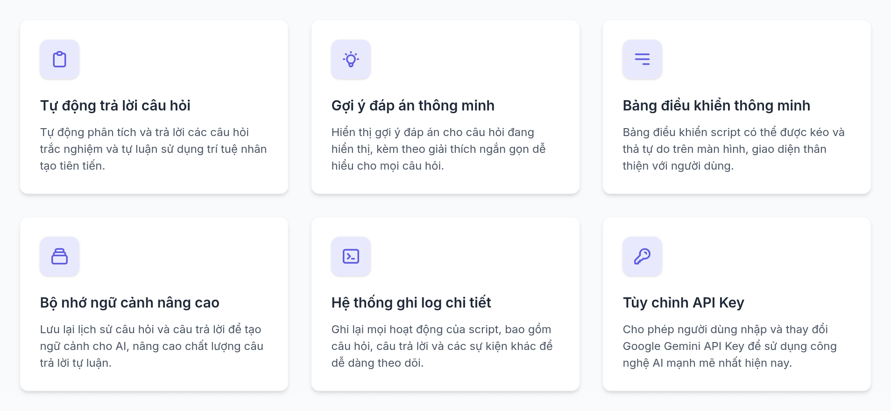
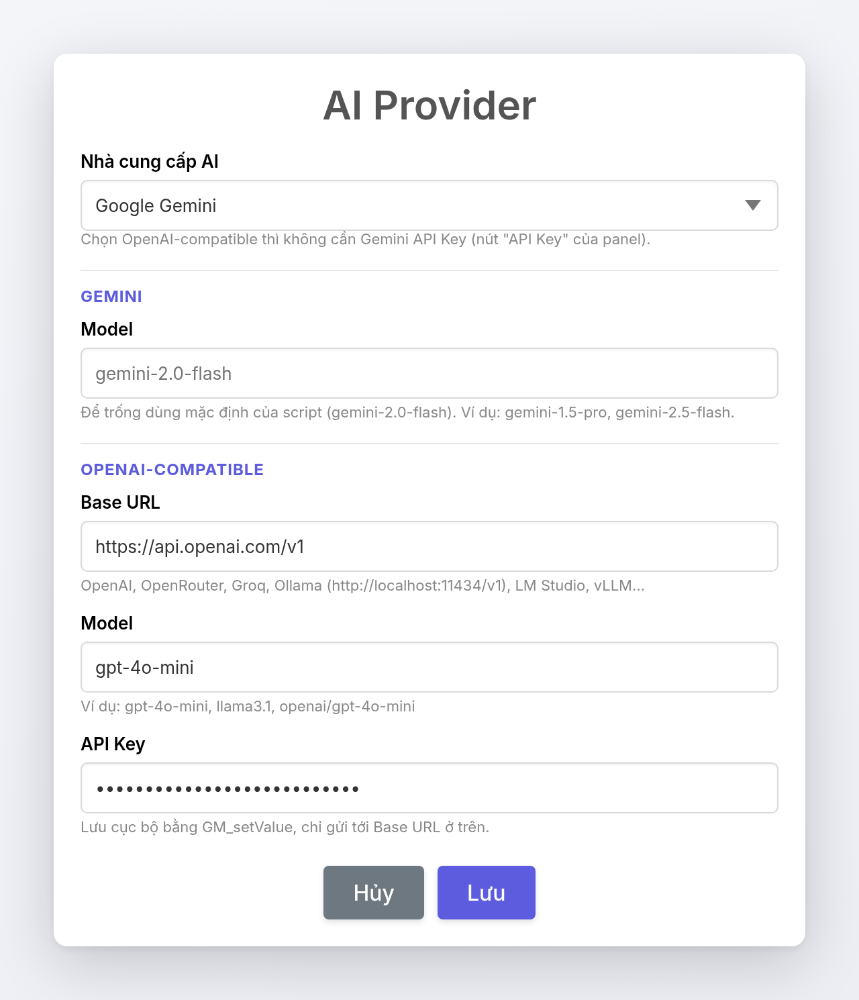
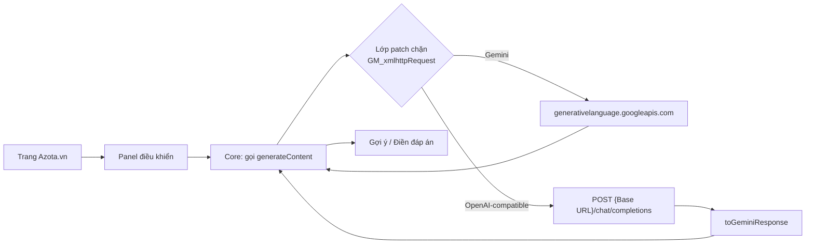

# AZOTA HUYNH DUONG DEV AUTO ĐÁP ÁN


Userscript Tampermonkey tự động trả lời câu hỏi trắc nghiệm và tự luận trên [Azota.vn](https://azota.vn), dùng Google Gemini hoặc bất kỳ endpoint OpenAI-compatible nào.

<sub>**English**: A Tampermonkey userscript that answers Azota.vn quizzes through Google Gemini's `generateContent` API, with a compatibility layer that proxies the same request to any OpenAI-compatible `/chat/completions` endpoint and translates the reply back.</sub>

> [!WARNING]
> Tính năng tự động trả lời có thể vi phạm điều khoản dịch vụ của Azota và khiến tài khoản bị khoá. Script được viết cho mục đích học tập — hãy dùng nút **Huỳnh Dương gợi ý** nếu bạn chỉ muốn tham khảo đáp án.

---

## Showcase



| Bảng điều khiển | Gợi ý đáp án |
| --- | --- |
|  |  |



**Cấu hình nhà cung cấp AI** — hộp thoại mở từ nút `⚙ AI Provider`:



<sub>Ảnh đầu, bảng điều khiển, thẻ gợi ý và lưới tính năng được render trực tiếp từ `index.html`. Riêng ảnh hộp thoại AI Provider là mockup dựng lại theo `buildSettingsHtml()` và CSS SweetAlert2 trong `azota.js` — không phải ảnh chụp màn hình trực tiếp trên Azota.</sub>

## Tính năng

- **Tự động trả lời** — phân tích và điền đáp án cho cả câu hỏi trắc nghiệm và tự luận.
- **Gợi ý đáp án** — hiển thị đáp án kèm giải thích ngắn gọn cho câu hỏi đang mở, không tự điền.
- **Bảng điều khiển kéo thả** — di chuyển, thu gọn/mở rộng, hiển thị trạng thái xử lý.
- **Bộ nhớ ngữ cảnh (thử nghiệm)** — lưu tối đa 5 cặp câu hỏi/đáp án gần nhất để làm ngữ cảnh cho câu tự luận tiếp theo.
- **Ghi log chi tiết** — theo dõi câu hỏi, câu trả lời, lỗi và request ngay trong panel.
- **Đổi nhà cung cấp AI** — Google Gemini (mặc định) hoặc endpoint OpenAI-compatible; đổi được cả model.
- **Lưu cấu hình cục bộ** — bằng `GM_setValue`, không cần tải lại trang khi đổi cấu hình.

## Cách hoạt động

Script chèn một panel vào trang Azota. Khi bạn bấm auto hoặc gợi ý, phần core (đã obfuscate) đọc câu hỏi trên trang và gọi Gemini `generateContent`. Lớp patch nằm trên đầu file chặn `GM_xmlhttpRequest` và quyết định request đó đi thẳng tới Google hay được dịch sang endpoint OpenAI-compatible.



Chi tiết về lớp adapter, cách dịch request/response và các giới hạn: xem [docs/ARCHITECTURE.md](docs/ARCHITECTURE.md).

## Cài đặt

**Cách 1 — cài một lần bằng link:**

1. Cài [Tampermonkey](https://www.tampermonkey.net/) cho Chrome, Firefox, Edge hoặc Safari.
2. Mở link cài đặt: [`azota.js`](https://raw.githubusercontent.com/TraiNguyenVan/Azota-Bypass/main/azota.js).
3. Tampermonkey sẽ hỏi cài đặt — bấm **Install**.

**Cách 2 — dán thủ công:**

1. Mở dashboard Tampermonkey → **+** (Create a new script).
2. Xoá nội dung mẫu, dán toàn bộ [`azota.js`](azota.js), lưu lại (`Ctrl/Cmd + S`).

Sau khi cài, mở Azota.vn và tải lại trang. Không có bước build — file `.js` chính là sản phẩm cuối.

## Cấu hình

Bấm nút **⚙ AI Provider** ở góc dưới bên phải trang Azota.

| Trường | Mặc định | Ghi chú |
| --- | --- | --- |
| Nhà cung cấp | `Google Gemini` | Chọn `OpenAI-compatible endpoint` để dùng endpoint khác |
| Gemini › Model | *(trống)* | Trống = model mặc định của script (`gemini-2.0-flash`); ví dụ `gemini-1.5-pro`, `gemini-2.5-flash` |
| OpenAI › Base URL | `https://api.openai.com/v1` | OpenAI, OpenRouter, Groq, Ollama (`http://localhost:11434/v1`), LM Studio, vLLM… |
| OpenAI › Model | `gpt-4o-mini` | Ví dụ `gpt-4o-mini`, `llama3.1`, `openai/gpt-4o-mini` |
| OpenAI › API Key | *(trống)* | Gửi dạng `Authorization: Bearer …` |

Lưu ý khi dùng chế độ OpenAI-compatible:

- Không cần Gemini API Key — script tự đặt một giá trị giữ chỗ để bỏ qua bước kiểm tra key lúc khởi động.
- Lần đầu chuyển sang chế độ này có thể cần tải lại trang một lần.
- Cần `GM_xmlhttpRequest` ghi đè được. Nếu trình quản lý userscript chặn (console có cảnh báo `[Azota]`), chế độ này sẽ không bật.

Cấu hình được lưu theo các khoá: `azota_provider`, `azota_gemini_model`, `azota_openai_base_url`, `azota_openai_model`, `azota_openai_api_key`.

## Sử dụng

| Nút | Chức năng |
| --- | --- |
| **Bắt đầu Auto (Huỳnh Dương)** | Tự động trả lời toàn bộ câu hỏi trên trang |
| **Huỳnh Dương gợi ý** | Chỉ hiện đáp án + giải thích cho câu đang mở |
| **API Key** | Nhập/thay Gemini API Key |
| **Hiện Log** | Mở log chi tiết của script |
| **⚙ AI Provider** | Chọn provider và model (nút nổi riêng, góc dưới phải) |

## Yêu cầu

- Trình duyệt có Tampermonkey (hoặc userscript manager tương thích `GM_xmlhttpRequest`, `GM_setValue`, `GM_getValue`).
- Gemini API Key hợp lệ — hoặc API Key của endpoint OpenAI-compatible nếu dùng chế độ đó. Tạo key tại [Google AI Studio](https://aistudio.google.com/app/apikey).
- Kết nối Internet ổn định.
- Tài khoản Azota.vn.

Script tải thêm hai thư viện qua CDN: SweetAlert2 11 và jQuery 3.6.0.

## Cấu trúc repo

```text
Azota-Bypass/
├── azota.js              # Userscript: lớp patch đọc được + core đã obfuscate
├── index.html            # Landing page tĩnh (Tailwind CDN, không cần build)
├── README.md
├── CHANGELOG.md
└── docs/
    ├── ARCHITECTURE.md   # Lớp adapter Gemini → OpenAI-compatible
    └── images/           # Ảnh showcase dùng trong README
```

## Giới hạn đã biết

- **Không có build, test hay lint** — repo chỉ gồm file tĩnh; mọi thay đổi phải kiểm tra thủ công trên trình duyệt.
- **Core đã obfuscate** — chỉ lớp patch ở đầu `azota.js` là mã nguồn đọc được; muốn sửa logic trả lời phải sửa trong phần đã obfuscate.
- **Độ chính xác không tuyệt đối** — câu hỏi định dạng đặc biệt có thể không được nhận dạng đúng, cần chỉnh tay.
- **Phụ thuộc CDN** — nếu SweetAlert2/jQuery không tải được, script tự lùi về `window.prompt`/`alert`.

## Ghi chú pháp lý

Script dùng cho mục đích học tập. Việc tự động trả lời có thể vi phạm điều khoản dịch vụ của Azota; người dùng tự chịu rủi ro với tài khoản của mình.

## Đóng góp & lịch sử

- Lịch sử thay đổi: [CHANGELOG.md](CHANGELOG.md)
- Kiến trúc chi tiết: [docs/ARCHITECTURE.md](docs/ARCHITECTURE.md)
- Landing page: [index.html](index.html)

## Giấy phép

MIT — theo khai báo `@license MIT` trong header userscript.
