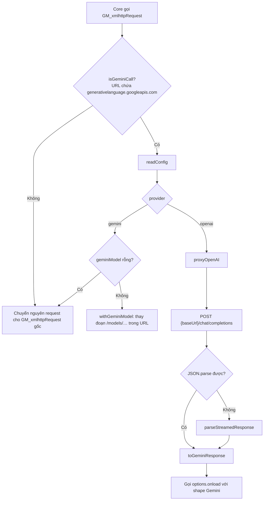

# Kiến trúc

`azota.js` gồm hai lớp nằm trong cùng một file userscript:

1. **Lớp patch** — toàn bộ đoạn mã giữa `[AZOTA-PATCH-START]` và `[AZOTA-PATCH-END]` ở đầu file. Đây là phần đọc được, chịu trách nhiệm chọn nhà cung cấp AI, dịch request/response và dựng hộp thoại cấu hình.
2. **Core** — phần thân đã obfuscate, đọc câu hỏi từ DOM Azota, gọi Gemini `generateContent` và điền đáp án.

Lớp patch không sửa core. Nó chỉ chặn `GM_xmlhttpRequest`, nên core vẫn tưởng mình đang nói chuyện với Google trong cả hai chế độ.

## Luồng request



`patchedRequest` chỉ can thiệp khi URL là Gemini; mọi request khác đi thẳng ra ngoài.

## Dịch request

`toChatRequest(geminiRequest, model)` chuyển payload Gemini sang Chat Completions:

| Gemini | OpenAI-compatible |
| --- | --- |
| `contents[].parts[].text` | `messages[].content` |
| role `model` | role `assistant` |
| role khác | role `user` |
| `generationConfig.temperature` | `temperature` |
| `generationConfig.topP` | `top_p` |
| `generationConfig.maxOutputTokens` | `max_tokens` |
| `generationConfig.stopSequences` | `stop` |

Request luôn được gửi với `stream: false`, dù endpoint vẫn có thể trả về dạng stream.

## Dịch response

`toGeminiResponse` dựng lại đúng cấu trúc core đang đọc:

```js
{ candidates: [{ content: { role: 'model', parts: [{ text }] }, finishReason: 'STOP' }] }
```

- `content` dạng chuỗi hoặc mảng part đều được gộp thành text (`contentToText`).
- Object `error` từ endpoint được trả nguyên cho core để hiển thị thông báo.
- Nếu endpoint trả về nội dung không phải JSON, `parseStreamedResponse` đọc từng dòng SSE (`data:`), bỏ qua `[DONE]`, dòng rỗng và chunk hỏng, rồi nối các `delta.content` lại. Sau đó nội dung đã nối đi qua `toGeminiResponse` như bình thường.

## Cấu hình

Tất cả giá trị nằm trong `GM_setValue`:

| Khoá | Ý nghĩa | Mặc định |
| --- | --- | --- |
| `azota_provider` | `gemini` hoặc `openai` | `gemini` |
| `azota_gemini_model` | Model Gemini, đã bỏ tiền tố `models/` | rỗng |
| `azota_openai_base_url` | Base URL của endpoint | `https://api.openai.com/v1` |
| `azota_openai_model` | Model gửi cho endpoint | `gpt-4o-mini` |
| `azota_openai_api_key` | Bearer token | rỗng |

`normalizeGeminiModel` chỉ chấp nhận ký tự `[A-Za-z0-9._-]`; tên model không hợp lệ bị bỏ qua và URL giữ nguyên.

### Giá trị giữ chỗ cho Gemini key

Core đọc Gemini key từ khoá `huynhDuongApiKey_v2_2` và dừng với thông báo "Chưa có API Key" nếu rỗng. Ở chế độ OpenAI-compatible, `ensureRuntimeKey` ghi giá trị `openai-compatible-proxy` vào khoá này để core khởi động được; giá trị đó không bao giờ được gửi đi vì URL Gemini đã bị thay bằng Base URL. Khi quay lại chế độ Gemini, giá trị giữ chỗ bị xoá.

## Giao diện cấu hình

`mountSettingsButton` chèn nút `⚙ AI Provider` cố định ở góc dưới phải (`z-index: 2147483647`). `openProviderSettings` mở hộp thoại SweetAlert2 dựng từ `buildSettingsHtml()`; nếu SweetAlert2 không tải được thì lùi về `window.prompt`.

Kiểm tra trước khi lưu:

- Chế độ OpenAI-compatible bắt buộc có Base URL và Model.
- Base URL phải bắt đầu bằng `http://` hoặc `https://`.
- Nếu adapter chưa ghi đè được `GM_xmlhttpRequest`, hộp thoại báo lỗi thay vì lưu cấu hình không dùng được.

Sau khi lưu, nếu đây là lần đầu bật chế độ OpenAI-compatible (khóa Gemini đang rỗng), script hỏi có tải lại trang hay không — core cần đọc lại key lúc khởi động.

## Ghi đè `GM_xmlhttpRequest`

Adapter thử gán vào biến toàn cục trước, rồi tới `window.GM_xmlhttpRequest`. Nếu cả hai đều thất bại (binding chỉ đọc), script ghi cảnh báo `[Azota]` vào console và giữ nguyên hành vi gốc — tùy chọn provider/model khi đó không có tác dụng.

## Ràng buộc

- **Timeout** mặc định 60 giây cho request chuyển tiếp; không có retry.
- **Không cache**: mỗi request đều đọc lại cấu hình từ `GM_setValue`.
- **`@connect *`** trong header là bắt buộc để gọi được Base URL tuỳ ý.
- **Core obfuscate**: mọi thay đổi liên quan tới đọc câu hỏi, prompt hay điền đáp án phải làm trong phần đã obfuscate, không nằm trong lớp patch.
- **Không có test tự động**: kiểm chứng bằng cách chạy userscript trên một bài Azota thật.

## Landing page

`index.html` là trang tĩnh: Tailwind qua CDN, font Inter + JetBrains Mono, tự bật dark mode theo `prefers-color-scheme`. Không có build step; mở trực tiếp bằng trình duyệt là chạy.
